# Proyecto Final — Diseño e Implementación de una Red Empresarial (Equipo 3)


> **Actualización de validación — 08/11/2026:** la documentación histórica de este archivo describe versiones anteriores del Employee Tracker. La variante actual transmite lecturas sintéticas por Bluetooth **desde el beacon**, PC4 las reenvía por TCP y PC7 recibe alertas. Consultar [cierre funcional](CIERRE_FUNCIONAL_2026-11-08.md) y [capturas 08/11](EVIDENCIAS_VALIDACION_2026-11-08.md). No interpretar pruebas IPsec IPv4 como demostración de cifrado del túnel IPv6.

**Asignatura:** Redes y Comunicación de Datos (2026-2)  
**Integrantes:** Juan David Rubio · Yeison David Niño · Miguel Medina  
**Parámetro de Equipo:** $X = 3$ · **Dominio Corporativo:** `mvydjdr.net`  
**Montaje de entrega:** [`Proyecto_RCD_Final.pkt`](../Proyecto_RCD_Final.pkt). Se conservan [la copia anterior](../Proyecto_Final_RCD_Equipo3.pkt) y [el montaje histórico alternativo](../Proyecto_FINAL.pkt).

[Estado y alcance](../ESTADO_FINAL_2026-11-08.md) · [Operación](SERVICIOS_MANUALES.md) · [Exportaciones](../configuraciones/README.md) · [Evidencias](EVIDENCIAS_VALIDACION_2026-11-08.md) · [Declaración de IA](../DECLARACION_IA.md)

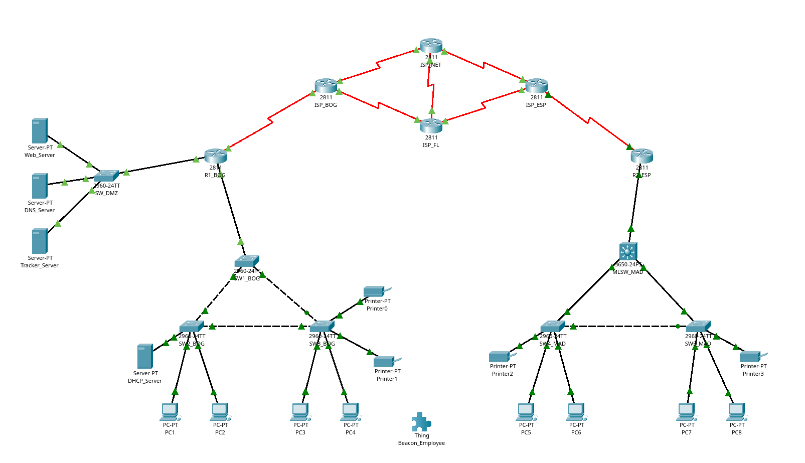

---

## 1. Síntesis de la Metodología Estructurada

Para garantizar un diseño escalable, seguro y verificable en Cisco Packet Tracer, el equipo aplicó una metodología de ingeniería de redes estructurada en cinco fases secuenciales [1], [2]:

1. **Análisis de Requerimientos y Dimensionamiento:** Identificación de las dos sedes corporativas (**Intranet Bogotá** e **Intranet Madrid**), la zona desmilitarizada (**DMZ**), el núcleo **WAN de proveedores (ISP)**, los perfiles de usuario por VLAN y los requerimientos de la aplicación IoT/TCP **Employee Tracker**.
2. **Diseño Lógico y Esquema de Direccionamiento (IPv6 / IPv4):** Particionamiento jerárquico de los bloques asignados con $X = 3$, definiendo subredes `/30` en la WAN IPv4, prefijos `/64` por VLAN en IPv6 (`2001:1200:EA13::/48` en Bogotá, `2001:1200:EB23::/48` en Madrid y `2001:1200:EC13::/48` en DMZ) y direccionamiento dual-stack de soporte.
3. **Montaje Físico y Conmutación LAN:** Despliegue de 6 routers Cisco `2811` (con módulos seriales `NM-4A/S`), 6 switches `2960-24TT`, 1 Multilayer Switch `3650-24PS`, 4 servidores, 8 PCs, 4 impresoras y el nodo beacon (`32` dispositivos totales considerando las 2 fuentes de poder automáticas del3650 y `32` enlaces).
4. **Configuración por Capas (Acceso, Red, Transporte y Aplicación):**
   * **Capa 2:** VLANs (`35`, `40`, `80`, `99`), enlaces troncales IEEE 802.1Q con VLAN nativa `99`, `Rapid-PVST+`, `PortFast` y `BPDUGuard`.
   * **Capa 3:** Inter-VLAN routing (`Router-on-a-Stick` en Bogotá y `SVIs` en el `3650` de Madrid), enrutamiento dinámico `EIGRP AS 3` y `OSPFv2 Proceso 3` con redistribución mutua en `ISP_FL`, túnel `ipv6ip` (`Tunnel0`), `OSPFv3 Proceso 3` y VPN `IPsec` (`AES-256/SHA`).
   * **Capas 4–7:** Listas de control de acceso (`WEB-DMZ`, `SNMP-INTERNAL`), servicios `DNS`, `HTTP/HTTPS`, `DHCP/SLAAC`, gestión `SNMPv2c` (`RO`/`RW`) y programación de sockets TCP en JavaScript para el sistema **Employee Tracker**.
5. **Verificación Funcional y Pruebas de Regresión:** Validación mediante pings extremo a extremo, resolución DNS (`A`/`AAAA`), pruebas de filtrado HTTP/HTTPS, operaciones `GET`/`SET` y bloqueo en MIB Browser, telemetría y alertas del Tracker, e inspección de PDUs en *Simulation Mode*.

### Comparación de Alternativas de Diseño

| Componente | Alternativas Evaluadas | Decisión Adoptada y Justificación de Ingeniería |
|---|---|---|
| **Enrutamiento Inter-VLAN en Bogotá** | Switch Capa 3 adicional vs. *Router-on-a-Stick* en `R1_BOG` | **Router-on-a-Stick (`Fa0/0.35`, `.40`, `.80`, `.99`):** Respeta fielmente la topología física exigida en la Figura 1 reutilizando `R1_BOG`, segmentando el tráfico mediante subinterfaces 802.1Q. |
| **Enrutamiento Inter-VLAN en Madrid** | *Router-on-a-Stick* en `R2_ESP` vs. Switch Multicapa `3650` (`MLSW_MAD`) | **Switch Multicapa `3650` con SVIs (`ip routing`):** Cumple el requisito del enunciado, procesa el tráfico intra-sede a velocidad de hardware en Capa 3 y descarga al router de borde `R2_ESP` mediante un enlace enrutado `/30` y `/64`. |
| **Redundancia LAN en Switches** | Topología en árbol simple vs. Topología en anillo/triángulo con STP | **Triángulo redundante con `Rapid-PVST+`:** Evita puntos únicos de falla en el cableado horizontal y previene tormentas de broadcast bloqueando lógicamente un puerto alternativo mientras converge en segundos ante caídas. |
| **Asignación de Direcciones IPv6** | Estática pura, DHCPv6 Stateful o SLAAC + DHCPv6 Stateless | **SLAAC + DHCPv6 Stateless (`other-config-flag`) + Respaldo Estático:** Los routers anuncian el prefijo `/64` mediante mensajes RA (`RFC 4862`) [3] y entregan el servidor DNS (`2001:1200:EC13:10::53`) y el dominio `mvydjdr.net` por DHCPv6 sin estado. |
| **Mecanismo de Transición IPv6 sobre WAN IPv4** | Doble pila en todo el ISP, Túnel GRE o Túnel Manual `ipv6ip` (Protocolo 41) | **Túnel `ipv6ip` (`Tunnel0`) entre `R1_BOG` y `R2_ESP`:** Permite transportar paquetes IPv6 nativos y adyacencias `OSPFv3` [4] sobre un núcleo ISP puramente IPv4 sin requerir soporte IPv6 en los proveedores intermedios (`ISP_BOG`, `ISP_NET`, `ISP_FL`, `ISP_ESP`). |
| **Seguridad en el Transporte WAN y Acceso** | Solo ACLs perimetrales vs. Defensa en profundidad (ACLs + VPN IPsec + SNMP ACL + SSHv2) | **Defensa en profundidad:** `IPsec` (`ESP AES-256 + SHA-1`) protege el tráfico IPv4 seleccionado entre sedes [5], `WEB-DMZ` segrega HTTP/HTTPS por rol de usuario y `SNMP-INTERNAL` restringe el plano de gestión exclusivamente a la VLAN 80. |

---

## 2. Esquema de Direccionamiento IPv4 e IPv6 y Tablas de Subredes

Con el número de grupo asignado **$X = 3$**, se construyeron los espacios de direccionamiento siguiendo la guía de diseño estructurado:

### 2.1. Subneteo del Núcleo WAN IPv4 (`86.106.79.0/24`)
El bloque público de Internet `86.106.7X.0/24` $\rightarrow$ **`86.106.79.0/24`** se subdividió utilizando VLSM con prefijo **`/30`** (`255.255.255.252`) para enlaces punto a punto seriales. Cada subred `/30` aporta $2^{32-30} = 4$ direcciones ($2$ utilizables), evitando el desperdicio de direcciones IPv4 públicas:

| Enlace WAN | Subred `/30` | Máscara | Extremo A (DCE/DTE) | Dirección IP A | Extremo B | Dirección IP B | Protocolo de Enrutamiento |
|---|---|---|---|---|---|---|---|
| **Enlace 1** | `86.106.79.0/30` | `255.255.255.252` | `R1_BOG` (`S1/0`) | `86.106.79.1` | `ISP_BOG` (`S1/0`) | `86.106.79.2` | `EIGRP AS 3` |
| **Enlace 2** | `86.106.79.4/30` | `255.255.255.252` | `ISP_BOG` (`S1/1`) | `86.106.79.5` | `ISP_NET` (`S1/0`) | `86.106.79.6` | `EIGRP AS 3` |
| **Enlace 3** | `86.106.79.8/30` | `255.255.255.252` | `ISP_NET` (`S1/1`) | `86.106.79.9` | `ISP_ESP` (`S1/0`) | `86.106.79.10` | `EIGRP AS 3` |
| **Enlace 4** | `86.106.79.12/30` | `255.255.255.252` | `ISP_ESP` (`S1/1`) | `86.106.79.13` | `ISP_FL` (`S1/1`) | `86.106.79.14` | `OSPFv2 Proceso 3 (Área 0)` |
| **Enlace 5** | `86.106.79.16/30` | `255.255.255.252` | `ISP_BOG` (`S1/2`) | `86.106.79.17` | `ISP_FL` (`S1/0`) | `86.106.79.18` | `OSPFv2 Proceso 3 (Área 0)` |
| **Enlace 6** | `86.106.79.20/30` | `255.255.255.252` | `ISP_NET` (`S1/2`) | `86.106.79.21` | `ISP_FL` (`S1/2`) | `86.106.79.22` | `EIGRP AS 3` |
| **Enlace 7** | `86.106.79.24/30` | `255.255.255.252` | `ISP_ESP` (`S1/2`) | `86.106.79.25` | `R2_ESP` (`S1/0`) | `86.106.79.26` | `EIGRP AS 3` |

*(El rango `86.106.79.28` a `86.106.79.255` permanece libre como reserva para crecimiento futuro).*

### 2.2. Tabla de Subredes LAN, DMZ, Tránsito y Túnel (IPv6 e IPv4)
Para las intranets se reemplazó $X = 3$ en los prefijos `/48` del enunciado, asignando el cuarto hexteto según el identificador de la VLAN:
* **Intranet Bogotá (`2001:1200:EA13::/48`):** Subredes `2001:1200:EA13:<VLAN>::/64`
* **Intranet Madrid (`2001:1200:EB23::/48`):** Subredes `2001:1200:EB23:<VLAN>::/64`
* **DMZ y Enlaces Bogotá (`2001:1200:EC13::/48`):** Subred DMZ `2001:1200:EC13:10::/64`
* **Loopbacks y Túnel (`2001:1200:ED13::/48`):** Subred Tunnel0 `2001:1200:ED13:300::/64`

| Sede / Zona | VLAN / ID | Función del Segmento | Prefijo IPv6 `/64` | Gateway IPv6 | Red IPv4 de Soporte | Gateway IPv4 | Método de Asignación |
|---|---|---|---|---|---|---|---|
| **Bogotá** | `VLAN 35` | Guest (Invitados) | `2001:1200:EA13:35::/64` | `2001:1200:EA13:35::1` | `10.3.35.0/24` | `10.3.35.1` | SLAAC + DHCPv6 Stateless / DHCPv4 |
| **Bogotá** | `VLAN 40` | Services (Impresoras/DHCP) | `2001:1200:EA13:40::/64` | `2001:1200:EA13:40::1` | `10.3.40.0/24` | `10.3.40.1` | Estático / SLAAC |
| **Bogotá** | `VLAN 80` | Internal (Empleados) | `2001:1200:EA13:80::/64` | `2001:1200:EA13:80::1` | `10.3.80.0/24` | `10.3.80.1` | SLAAC + DHCPv6 Stateless / DHCPv4 |
| **Bogotá** | `VLAN 99` | Management / Nativa | `2001:1200:EA13:99::/64` | `2001:1200:EA13:99::1` | `10.3.99.0/24` | `10.3.99.1` | Estático (Switches L2) |
| **Madrid** | `VLAN 35` | Guest (Invitados) | `2001:1200:EB23:35::/64` | `2001:1200:EB23:35::1` | `10.3.135.0/24` | `10.3.135.1` | SLAAC + DHCPv6 Stateless / DHCPv4 |
| **Madrid** | `VLAN 40` | Services (Impresoras) | `2001:1200:EB23:40::/64` | `2001:1200:EB23:40::1` | `10.3.140.0/24` | `10.3.140.1` | Estático / SLAAC |
| **Madrid** | `VLAN 80` | Internal (Empleados) | `2001:1200:EB23:80::/64` | `2001:1200:EB23:80::1` | `10.3.81.0/24` | `10.3.81.1` | SLAAC + DHCPv6 Stateless / DHCPv4 |
| **Madrid** | `VLAN 99` | Management / Nativa | `2001:1200:EB23:99::/64` | `2001:1200:EB23:99::1` | `10.3.199.0/24` | `10.3.199.1` | Estático (Switches L2) |
| **DMZ (BOG)** | `VLAN 40` | Servidores Corporativos | `2001:1200:EC13:10::/64` | `2001:1200:EC13:10::1` | `10.3.10.0/24` | `10.3.10.1` | Estático |
| **Tránsito MAD**| `L3 PtP` | Enlace `R2_ESP` $\leftrightarrow$ `MLSW_MAD` | `2001:1200:EB23:200::/64` | `::1` (`R2`) / `::2` (`MLSW`) | `10.3.200.0/30` | `.1` (`R2`) / `.2` (`MLSW`)| Estático |
| **Túnel IPv6** | `Tunnel0` | Overlay `R1_BOG` $\leftrightarrow$ `R2_ESP` | `2001:1200:ED13:300::/64` | `::1` (`R1`) / `::2` (`R2`) | Encapsulado en IP 41 | `86.106.79.1` $\leftrightarrow$ `.26` | Estático (`ipv6ip`) |

### 2.3. Direccionamiento de Servidores, Terminales y Equipos de Gestión

| Dispositivo | Sede / Ubicación | Rol / VLAN | Dirección IPv6 | Gateway IPv6 | Dirección IPv4 | Gateway IPv4 | Servidor DNS |
|---|---|---|---|---|---|---|---|
| `Web_Server` | DMZ | Servidor HTTP/HTTPS | `2001:1200:EC13:10::80/64` | `2001:1200:EC13:10::1` | `10.3.10.80/24` | `10.3.10.1` | `2001:1200:EC13:10::53` |
| `DNS_Server` | DMZ | Servidor DNS (`mvydjdr.net`)| `2001:1200:EC13:10::53/64` | `2001:1200:EC13:10::1` | `10.3.10.53/24` | `10.3.10.1` | `2001:1200:EC13:10::53` |
| `Tracker_Server`| DMZ | Servidor Tracker Relay | `2001:1200:EC13:10::50/64` | `2001:1200:EC13:10::1` | `10.3.10.50/24` | `10.3.10.1` | `2001:1200:EC13:10::53` |
| `DHCP_Server` | Bogotá | VLAN 40 Services | `2001:1200:EA13:40::10/64` | `2001:1200:EA13:40::1` | `10.3.40.10/24` | `10.3.40.1` | `2001:1200:EC13:10::53` |
| `PC1` | Bogotá | VLAN 35 (Guest) | `2001:1200:EA13:35::11/64` | `2001:1200:EA13:35::1` | `10.3.35.11/24` | `10.3.35.1` | `2001:1200:EC13:10::53` |
| `PC2` | Bogotá | VLAN 80 (Internal) | `2001:1200:EA13:80::12/64` | `2001:1200:EA13:80::1` | `10.3.80.12/24` | `10.3.80.1` | `2001:1200:EC13:10::53` |
| `PC3` | Bogotá | VLAN 80 (Internal) | `2001:1200:EA13:80::13/64` | `2001:1200:EA13:80::1` | `10.3.80.13/24` | `10.3.80.1` | `2001:1200:EC13:10::53` |
| `PC4` | Bogotá | VLAN 80 (Tracker App) | `2001:1200:EA13:80::14/64` | `2001:1200:EA13:80::1` | `10.3.80.14/24` | `10.3.80.1` | `2001:1200:EC13:10::53` |
| `PC5` | Madrid | VLAN 35 (Guest) | `2001:1200:EB23:35::15/64` | `2001:1200:EB23:35::1` | `10.3.135.15/24` | `10.3.135.1` | `2001:1200:EC13:10::53` |
| `PC6` | Madrid | VLAN 80 (Internal) | `2001:1200:EB23:80::16/64` | `2001:1200:EB23:80::1` | `10.3.81.16/24` | `10.3.81.1` | `2001:1200:EC13:10::53` |
| `PC7` | Madrid | VLAN 80 (Tracker Dashboard)| `2001:1200:EB23:80::17/64` | `2001:1200:EB23:80::1` | `10.3.81.17/24` | `10.3.81.1` | `2001:1200:EC13:10::53` |
| `PC8` | Madrid | VLAN 35 (Guest) | `2001:1200:EB23:35::18/64` | `2001:1200:EB23:35::1` | `10.3.135.18/24` | `10.3.135.1` | `2001:1200:EC13:10::53` |
| `SW1`–`SW3`, `SW_DMZ`| Bogotá / DMZ | VLAN 99 Management | — | — | `10.3.99.11` a `.14` | `10.3.99.1` | — |
| `SW4`–`SW5` | Madrid | VLAN 99 Management | — | — | `10.3.199.14` a `.15` | `10.3.199.1` | — |

---

## 3. Respuestas a las Preguntas Guía de la Sección de Procedimiento

### Pregunta 3: Asignación de Direccionamiento
> **¿Qué método(s) de asignación se debe(n) configurar? ¿En qué terminales se deben configurar los servicios requeridos?**

* **En los terminales de usuario (`PC1` a `PC8`):** Se utiliza asignación dinámica mediante **SLAAC (Stateless Address Autoconfiguration)** combinado con **DHCPv6 Stateless** (`ipv6 nd other-config-flag` y `ipv6 dhcp server` en `R1_BOG` y `MLSW_MAD`) para aprender el prefijo `/64`, el gateway por Router Advertisements (RA) y, mediante DHCPv6 sin estado, los parámetros de DNS (`2001:1200:EC13:10::53`) y dominio (`mvydjdr.net`). En IPv4, `DHCP_Server` (`10.3.40.10`) entrega direcciones mediante agentes de retransmisión (`ip helper-address 10.3.40.10`) configurados en las subinterfaces de `R1_BOG` y en las SVIs de `MLSW_MAD`. *(Como medida de persistencia ante la recarga del archivo `.pkt` en Packet Tracer, se documentan también las direcciones IPv6 fijas `::11` a `::18`).*
* **En servidores (`Web_Server`, `DNS_Server`, `Tracker_Server`, `DHCP_Server`), interfaces de routers y SVIs de gestión (`VLAN 99`):** Se debe configurar **direccionamiento estático**, ya que alojan servicios críticos que son referenciados por reglas de firewall (ACLs), registros DNS (`A` y `AAAA`), sockets TCP y agentes de monitoreo SNMP.

### Pregunta 4: Filtrado de Paquetes Web, DNS y Dominio
> **¿Qué servicio de red se debe configurar? ¿Dónde se deben ubicar los ACLs?**

* **Servicios a configurar:**
  1. **Servidor DNS (`DNS_Server` en `2001:1200:EC13:10::53`):** Configurado con el dominio **`mvydjdr.net`** (iniciales de **M**iguel, **Y**eison **D**avid, **J**uan **D**avid **R**ubio), asociando el registro `AAAA` a `2001:1200:EC13:10::80` y el registro `A` a `10.3.10.80`.
  2. **Servidor Web (`Web_Server` en `2001:1200:EC13:10::80`):** Con los servicios **HTTP (puerto 80)** y **HTTPS (puerto 443)** activos y una página HTML personalizada para el Equipo 3.
  3. **Listas de Control de Acceso Extendidas IPv6 (`ipv6 access-list WEB-DMZ`) e IPv4 (`ip access-list extended WEB-DMZ4`):**
     * Permiten `TCP 80 (www)` y deniegan `TCP 443` para las subredes **Guest (VLAN 35)** de Bogotá (`2001:1200:EA13:35::/64`) y Madrid (`2001:1200:EB23:35::/64`).
     * Permiten `TCP 443` y deniegan `TCP 80` para las subredes **Internal (VLAN 80)** de Bogotá (`2001:1200:EA13:80::/64`) y Madrid (`2001:1200:EB23:80::/64`).
* **Ubicación óptima de la ACL:** Se ubicó en el router **`R1_BOG` sobre la interfaz `FastEthernet0/1` en sentido saliente (`out`) hacia la DMZ** (`ipv6 traffic-filter WEB-DMZ out`). Al ser `R1_BOG` el único punto de entrada hacia la DMZ tanto para los usuarios locales de Bogotá como para los usuarios remotos de Madrid (que llegan a través de `Tunnel0`), **una sola ACL centralizada** aplica la política de forma consistente sin descartar tráfico inter-VLAN ni sobrecargar otros enlaces.

### Pregunta 5: Comunicación Intra/Inter-VLAN, Enlaces Troncales y Enrutamiento
> **¿En qué interfaces se deben configurar enlaces "Trunks" IEEE 802.1Q, OSPF o EIGRP, OSPFv3 y redistribución entre protocolos?**

* **Enlaces Troncales IEEE 802.1Q (`switchport mode trunk`, `native vlan 99`, `allowed vlan 35,40,80,99`):**
  * **Sede Bogotá:** En el enlace `SW1_BOG (Gi0/1)` $\leftrightarrow$ `R1_BOG (Fa0/0)` y en los enlaces del triángulo redundante. El [inventario histórico](../evidencias/final_exportacion.txt) identifica `Fa0/24` de SW1_BOG como el enlace a SW3_BOG.
  * **Sede Madrid:** En todos los enlaces inter-switch del triángulo formado por `MLSW_MAD` (`Gi1/0/2`, `Gi1/0/3`), `SW4_MAD` (`Gi0/1`, `Gi0/2`) y `SW5_MAD` (`Gi0/1`, `Gi0/2`).
* **Protocolos de Enrutamiento IPv4:**
  * **EIGRP AS 3:** Configurado en `R1_BOG` (redes LAN y enlace serial `S1/0`), `ISP_BOG` (`S1/0`, `S1/1`), `ISP_NET` (`S1/0`, `S1/1`, `S1/2`), `ISP_FL` (`S1/2`), `ISP_ESP` (`S1/0`, `S1/2`) y `R2_ESP` (`S1/0` + redistribución de rutas estáticas hacia Madrid).
  * **OSPFv2 Proceso 3 (Área 0):** Configurado en las interfaces del triángulo inferior del proveedor: `ISP_BOG` (`S1/2` - `86.106.79.16/30`), `ISP_FL` (`S1/0` y `S1/1`) e `ISP_ESP` (`S1/1` - `86.106.79.12/30`).
* **Protocolo de Enrutamiento IPv6 (`OSPFv3 Proceso 3 Área 0`):**
  * Configurado sobre la interfaz virtual **`Tunnel0`** entre `R1_BOG` y `R2_ESP`, en el enlace de tránsito Capa 3 `R2_ESP (Fa0/0)` $\leftrightarrow$ `MLSW_MAD (Gi1/0/1)`, en las subinterfaces LAN/DMZ de `R1_BOG` y en las interfaces `Vlan35`, `Vlan40`, `Vlan80` y `Vlan99` de `MLSW_MAD`.
* **Redistribución entre Protocolos:**
  * Se ejecuta **exclusivamente en `ISP_FL`** (`redistribute ospf 3 metric 10000 100 255 1 1500` dentro de `router eigrp 3` y `redistribute eigrp 3 subnets` dentro de `router ospf 3`). Para evitar bucles de retroalimentación por diferencia de distancia administrativa (EIGRP externo = `170` vs. OSPF = `110`), se configuró `distance ospf external 175` en los routers OSPF.

### Pregunta 6: Migración IPv6 y Seguridad entre Intranets
> **¿Qué servicio(s) de migración se debe(n) implementar para permitir el acceso al servidor Web en la DMZ IPv6 a través de Internet IPv4? ¿Qué servicios se deben configurar para tener una comunicación segura entre las Intranets? ¿Dónde se deben configurar?**

* **Servicio de Migración IPv6:** Se implementó un **Túnel Manual IPv6-sobre-IPv4 (`tunnel mode ipv6ip`, Protocolo IP 41)** en la interfaz **`Tunnel0`** entre los routers de borde **`R1_BOG`** (origen `Serial1/0` `86.106.79.1`, destino `86.106.79.26`, IP `2001:1200:ED13:300::1/64`) y **`R2_ESP`** (origen `Serial1/0` `86.106.79.26`, destino `86.106.79.1`, IP `2001:1200:ED13:300::2/64`). Esto encapsula los paquetes IPv6 dentro de cabeceras IPv4 para atravesar transparentemente la nube ISP IPv4.
* **Servicio de Comunicación Segura:** Se configuró un túnel **VPN IPsec Site-to-Site** con **IKEv1 (ISAKMP Policy 10)**: cifrado **`AES-256`**, hash **`SHA-1`**, autenticación por llave precompartida (**PSK**), Diffie-Hellman **Grupo 2** y **Transform-Set `RCD3-SET` (`esp-aes 256 esp-sha-hmac`)**.
* **Ubicación:** El `crypto map RCD3-MAP` se aplica en las interfaces físicas de salida hacia la WAN pública: **`Serial1/0` de `R1_BOG`** y **`Serial1/0` de `R2_ESP`**.

El [registro de IPsec](../evidencias/validacion_2026-11-08/05_tracker_bluetooth/r1_ipsec_esp_activa.txt) respalda ESP para el selector IPv4 observado. El cifrado del protocolo 41 y una DMZ completamente IPv6 siguen sin demostración.

### Pregunta 7: Gestión de Red con SNMP
> **¿Qué servicio debe configurar para denegar el uso de SNMP a las demás VLANs?**

* El diseño de gestión usa **SNMPv2c** con dos comunidades: **`RCD3-RO`** (Solo Lectura / *Read-Only*) y **`RCD3-RW`** (Lectura y Escritura / *Read-Write*).
* Para denegar el uso de SNMP a las VLANs no autorizadas (Guest 35, Services 40, Management 99 y WAN externa), se configuró la **Lista de Control de Acceso Extendida `SNMP-INTERNAL`**, que permite únicamente datagramas **UDP hacia el puerto `161` (`eq snmp`)** cuyo origen sea la subred **Internal de Bogotá (`10.3.80.0/24`)** o **Internal de Madrid (`10.3.81.0/24`)**, seguida de la sentencia explícita **`deny udp any any eq snmp`** y `permit ip any any` para el resto del tráfico. Esta ACL se aplicó en sentido entrante (`in`) en las subinterfaces de `R1_BOG`, en las SVIs de `MLSW_MAD` y en los puertos seriales WAN.

En Madrid, el acceso de PC7 a R2_ESP se documentó después de ajustar la ACL de retorno. Consulte el [GET/SET y el diagnóstico del switch multicapa](EVIDENCIAS_VALIDACION_2026-11-08.md#3-snmp-v2-operaciones-y-acceso-en-madrid).

### Pregunta 8: Servicios Adicionales Requeridos
> **Si requiere algún servicio adicional para el funcionamiento correcto de la red empresarial, presente y justifique el servicio requerido.**

1. **Agente de Retransmisión DHCP (`ip helper-address 10.3.40.10`):** Indispensable porque los mensajes `DHCPDISCOVER` son tramas de broadcast que no cruzan routers ni límites de VLAN; el *relay* convierte la solicitud en unicast hacia el `DHCP_Server` central ubicado en la VLAN 40 de Bogotá.
2. **Protocolo `SSHv2` (`transport input ssh`, `login local`) y Cifrado de Contraseñas (`service password-encryption`, `enable secret`):** Asegura la administración remota por consola virtual (`line vty 0 4`) evitando el envío de credenciales en texto plano que ocurriría con Telnet.
3. **Protección de Capa 2 (`Rapid-PVST+`, `spanning-tree portfast` y `bpduguard enable`):** Garantiza convergencia inmediata en los puertos de acceso hacia PCs/servidores y apaga automáticamente el puerto si alguien conecta un switch no autorizado que emita BPDUs.

---

## 4. Resultados y Análisis de la Experimentación

### 4.1. Montaje, Configuración y Validación de Protocolos y Servicios (Punto 2)

La tabla conserva las comprobaciones históricas. La [matriz Web de 16 casos](EVIDENCIAS_VALIDACION_2026-11-08.md#2-acl-web-ipv4-e-ipv6-matriz-de-16-pruebas) y el [cierre funcional](CIERRE_FUNCIONAL_2026-11-08.md) documentan los resultados posteriores.

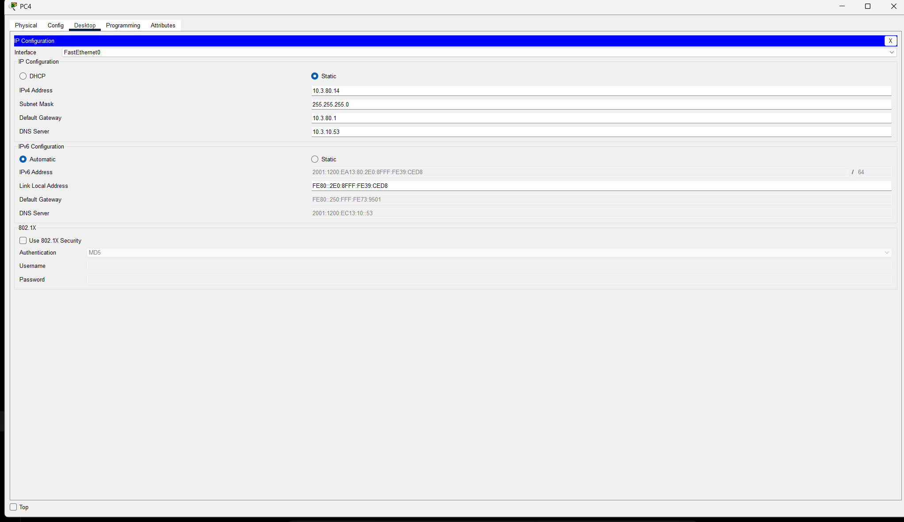

| Prueba Realizada | Origen $\rightarrow$ Destino | Protocolo / Herramienta | Resultado Obtenido | Estado |
|---|---|---|---|---|
| **Salud e Inventario** | Topología completa (32 nodos) | Inspección física y lógica | 32 dispositivos y 32 enlaces activos; 0 enlaces caídos, 0 IPs duplicadas | ✅ Verificado |
| **Convergencia WAN IPv4**| `R1_BOG` $\leftrightarrow$ `R2_ESP` | `EIGRP 3` + `OSPF 3` (`ping`) | 5/5 paquetes exitosos; redistribución limpia en `ISP_FL` sin bucles | ✅ Verificado |
| **Conectividad Inter-Sede**| `PC4` (BOG) $\leftrightarrow$ `PC7` (MAD)| ICMPv4 + VPN IPsec ESP | 4/4 respuestas en ambos sentidos; paquetes cifrados (`#pkts encaps`) | ✅ Verificado |
| **Túnel IPv6 y OSPFv3** | `PC7` (MAD) $\rightarrow$ `Web_Server` (DMZ)| ICMPv6 sobre `Tunnel0` | 4/4 respuestas exitosas hacia `2001:1200:EC13:10::80` | ✅ Verificado |
| **Resolución DNS** | `PC1`, `PC4`, `PC5`, `PC7` $\rightarrow$ DNS | `nslookup mvydjdr.net` | Resuelve registro `A` (`10.3.10.80`) y `AAAA` (`2001:1200:EC13:10::80`)| ✅ Verificado |
| **Matriz ACL Web (Guest)**| `PC1` (BOG) y `PC5` (MAD) $\rightarrow$ Web | Browser HTTP (80) / HTTPS (443)| **HTTP 80 Permitido** (carga página) · **HTTPS 443 Bloqueado** | ✅ Verificado |
| **Matriz ACL Web (Internal)**| `PC4` (BOG) y `PC7` (MAD) $\rightarrow$ Web| Browser HTTP (80) / HTTPS (443)| **HTTPS 443 Permitido** (carga página) · **HTTP 80 Bloqueado** | ✅ Verificado |

---

### 4.2. Evaluación del Flujo Bidireccional de la Solución "Employee Tracker" (Punto 3)

**Variante BLE de entrega.** Beacon_Employee genera lecturas sintéticas y las envía por Bluetooth a PC4. PC4 recibe y reenvía la trama por TCP al Tracker_Server (5000). El servidor devuelve un ACK de aplicación a PC4 y, con la conexión a PC7 disponible, reenvía el evento al Dashboard (5001). Ese ACK acredita recepción por el servidor. La recepción en el Dashboard se verifica por separado en su consola.

| Evidencia | Observación |
|---|---|
| [Beacon y PC4](../evidencias/validacion_2026-11-08/05_tracker_bluetooth/bluetooth_beacon_pc4.txt) | PC4 recibió el mensaje de prueba del beacon. |
| [Puente TCP](../evidencias/validacion_2026-11-08/05_tracker_bluetooth/pc4_tcp_ack_cambio_brusco.txt) | Reenvío de lecturas y ACK con `CAMBIO_BRUSCO`. |
| [Dashboard](../evidencias/validacion_2026-11-08/05_tracker_bluetooth/pc7_dashboard_zona_restringida.txt) | Recepción de eventos y alerta `ZONA_RESTRINGIDA`. |

#### Variante histórica con RCD Sender

Las capturas y el análisis de PDUs siguientes corresponden a la variante previa. En ella PC4 generaba la telemetría sintética. La [variante BLE](CIERRE_FUNCIONAL_2026-11-08.md) se respalda con las transcripciones de la tabla.

La variante histórica del **Employee Tracker** usa tres nodos a través de la red empresarial LAN-WAN utilizando **sockets TCP en JavaScript**:

1. **Generación y Emisión en `PC4` (`RCD Sender` — Bogotá VLAN 80, `10.3.80.14`):**
   * Abre un socket `TCPClient` hacia `Tracker_Server` en la DMZ (`10.3.10.50`, puerto **TCP `5000`**).
   * Cada segundo genera telemetría sintética (`EMP-001`) y transmite una trama delimitada por salto de línea con el formato:
     ```text
     EMP-001|<secuencia>|<timestamp>|<x>|<y>|<actividad>\n
     ```
   * Permanece a la escucha en el mismo socket bidireccional y registra el acuse de recibo enviado por el servidor:
     ```text
     ACK|<secuencia>|RECIBIDO|<estado_alerta>
     ```

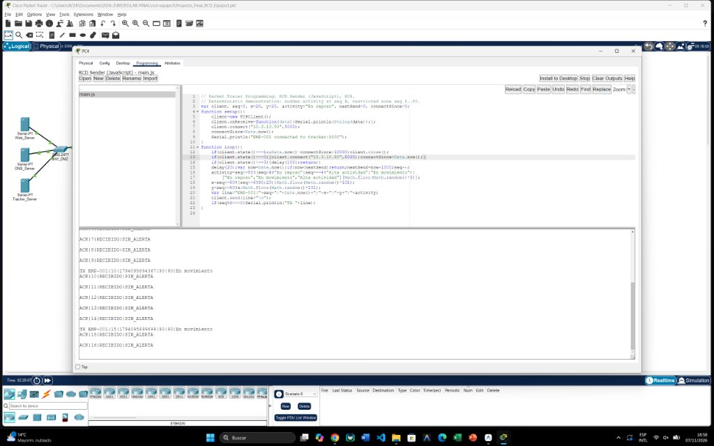

2. **Procesamiento, Reglas de Negocio y Retransmisión en `Tracker_Server` (`RCD Tracker` — DMZ, `10.3.10.50`):**
   * Escucha conexiones entrantes en `TCPServer` puerto **`5000`** y mantiene simultáneamente un socket `TCPClient` hacia el supervisor en `PC7` (`10.3.81.17`, puerto **TCP `5001`**).
   * Evalúa en tiempo real las dos condiciones de alerta exigidas por el enunciado:
     * **Alerta por actividad física anormal (`CAMBIO_BRUSCO`):** Se dispara de inmediato cuando el estado del empleado pasa repentinamente de `"En reposo"` a `"Alta actividad"` (demostrado en la **secuencia 4**).
     * **Alerta por permanencia en zona restringida (`ZONA_RESTRINGIDA`):** Cuando las coordenadas entran al cuadrante restringido ($X \ge 80, Y \ge 80$, demostrado con la posición `(90, 90)` a partir de la secuencia 6), el servidor contabiliza el tiempo continuo con `Date.now()`. Al alcanzar y superar los **60 segundos continuos** (`zona=61`, `zona=62`, ...), activa la alerta `ZONA_RESTRINGIDA`, notificando tanto a `PC7` como a `PC4` en el `ACK`.

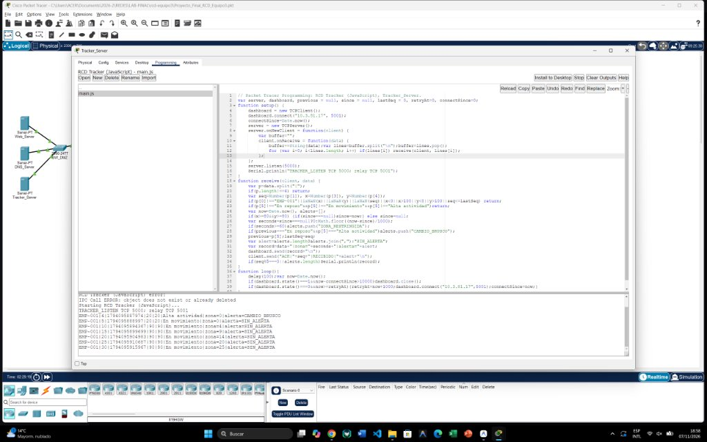

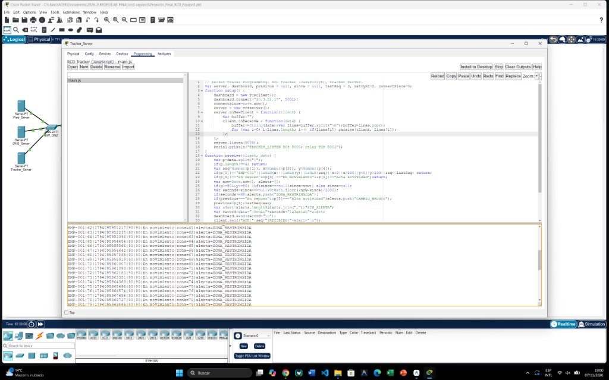

3. **Visualización en Tiempo Real en `PC7` (`RCD Dashboard` — Madrid VLAN 80, `10.3.81.17`):**
   * Escucha en `TCPServer` sobre el puerto **TCP `5001`**.
   * Recibe los paquetes reenviados desde la DMZ de Bogotá (que atraviesan el túnel VPN IPsec en la WAN y el switch multicapa `MLSW_MAD`), mostrando en tiempo real el último paquete (`ULTIMO`), la ventana rotativa de los últimos 10 registros (`HISTORIAL CORTO`) y las alertas activas.

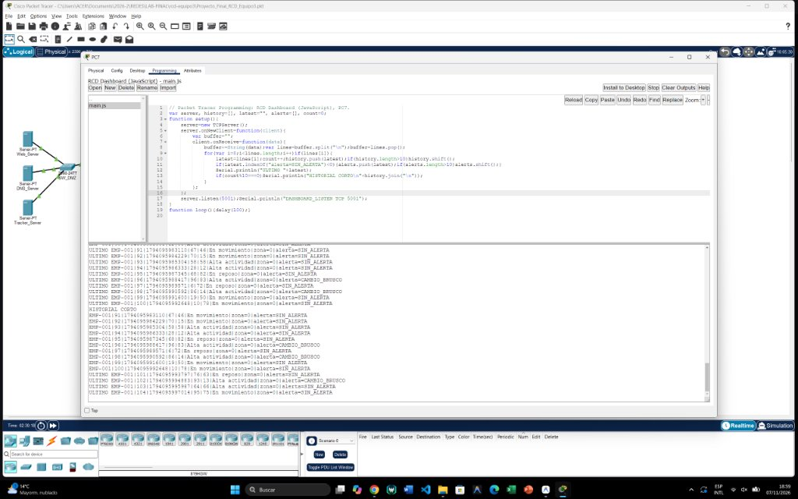

4. **Recorrido por Capas en Simulation Mode (Archivo [`evidencias/final_simulacion.txt`](../evidencias/final_simulacion.txt)):**
   * **Capa 4 (Transporte):** Segmentación TCP (`Src Port: 1025+`, `Dst Port: 5000` en el tramo `PC4` $\rightarrow$ `Tracker_Server`; y `Dst Port: 5001` en el tramo `Tracker_Server` $\rightarrow$ `PC7`), con números de secuencia y confirmación (`ACK`) bidireccionales.
   * **Capa 2 (Acceso LAN):** Etiquetado `802.1Q` en la VLAN 80 a través de `SW3_BOG` $\rightarrow$ `SW1_BOG` $\rightarrow$ `R1_BOG (Fa0/0.80)`.
   * **Capa 3 (Internet y Seguridad IPsec):** En el tramo hacia Madrid (`10.3.81.17`), `R1_BOG` evalúa la ACL `141` del `crypto map RCD3-MAP`, encapsula el paquete TCP dentro de un paquete **ESP (Protocolo IP 50)** cifrado con **AES-256**, lo enruta por `EIGRP`/`OSPF` en la WAN y `R2_ESP` lo descifra antes de entregarlo a `MLSW_MAD` (`Vlan80`) y finalmente a `PC7`.

---

### 4.3. Explicación y Evidencia del Flujo Bidireccional SNMP (`GET`, `SET` y Bloqueo por ACL) (Punto 4)

#### Madrid (8 de noviembre)

PC7 (`10.3.81.17`) envió las consultas al agente `R2_ESP` (`10.3.200.1`) por UDP/161. La respuesta del agente sale de UDP/161 hacia el puerto de origen del gestor. Tras aplicar la excepción de retorno reportada en `MLSW_MAD`, PC7 obtuvo `sysName.0 = R2_ESP`, escribió `sysLocation.0` y verificó el valor con otro GET. PC5 obtuvo timeout. Los contadores de la ACL respaldan el filtrado agregado. La PDU de PC7 hacia el propio `MLSW_MAD` llegó al switch y la sesión registró timeout, con causa aún indeterminada.

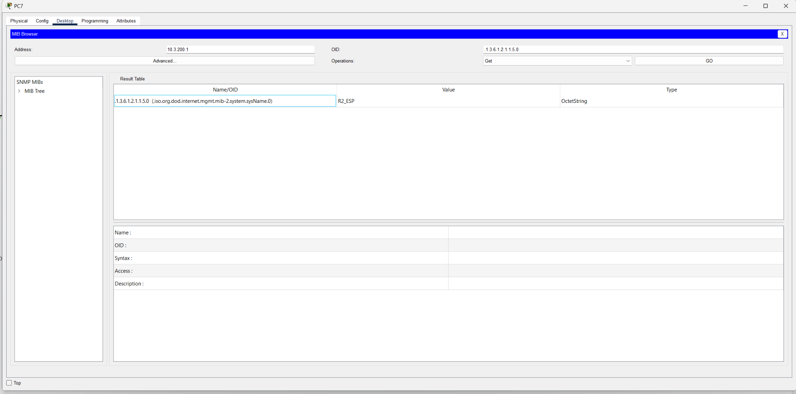

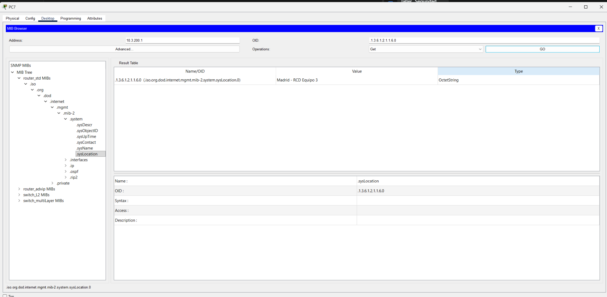

[Secuencia GET/SET, prueba de invitado y diagnóstico en Simulation Mode](EVIDENCIAS_VALIDACION_2026-11-08.md#3-snmp-v2-operaciones-y-acceso-en-madrid)

#### Bogotá (evidencia histórica)

El protocolo **SNMP (Simple Network Management Protocol)** opera en la capa de aplicación sobre **UDP puerto 161** (consultas hacia el agente) siguiendo un flujo solicitud-respuesta entre el **Gestor (*SNMP Manager*, MIB Browser en el PC)** y el **Agente (*SNMP Agent*, router o switch IOS)** [6]:

1. **Operación `SNMP GET` desde la Red Interna Autorizada (`PC4` - `10.3.80.14` $\rightarrow$ `R1_BOG` - `10.3.80.1`):**
   * Desde `PC4` (VLAN 80 Internal Bogotá) se envió una PDU **`GetRequest`** autenticada con la comunidad de lectura **`RCD3-RO`** consultando el OID **`.1.3.6.1.2.1.1.5.0`** (`iso.org.dod.internet.mgmt.mib-2.system.sysName.0`).
   * El paquete ingresa a `R1_BOG` por `FastEthernet0/0.80`, es permitido por la política de acceso, el proceso SNMP local busca la variable en su árbol MIB y devuelve un datagrama **`GetResponse`** desde el puerto UDP 161 hacia el puerto efímero de `PC4` con el valor `OctetString`: **`R1_BOG`**.

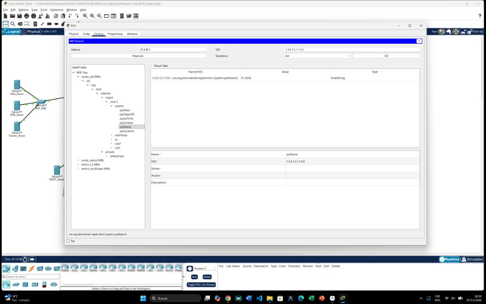

2. **Operación `SNMP SET` y Verificación desde la Red Interna (`PC4` $\rightarrow$ `R1_BOG`):**
   * Utilizando la comunidad de lectura/escritura **`RCD3-RW`**, `PC4` envió una PDU **`SetRequest`** sobre el OID **`.1.3.6.1.2.1.1.6.0`** (`sysLocation.0`) con tipo `OctetString` y valor **`Sede_Bogota_RCD3`**.
   * El agente valida el permiso `RW` de la comunidad, modifica la variable en memoria de ejecución y retorna un **`GetResponse`** sin error confirmando el nuevo valor **`Sede_Bogota_RCD3`**, lo cual se corroboró con una consulta `GET` posterior.

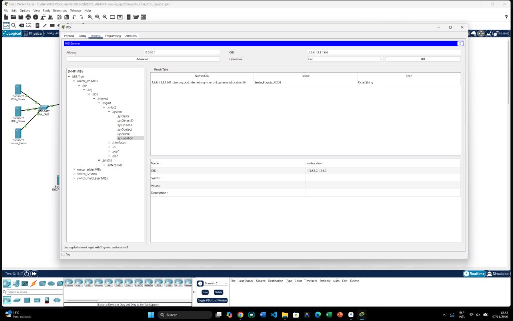

3. **Bloqueo de SNMP desde VLAN No Autorizada (`PC1` Guest VLAN 35 - `10.3.35.11` $\rightarrow$ `R1_BOG` - `10.3.80.1`):**
   * Al intentar exactamente el mismo `GetRequest` hacia `.1.3.6.1.2.1.1.5.0` desde **`PC1` (VLAN 35 Invitados)**, el datagrama UDP con destino al puerto `161` llega a la subinterfaz `FastEthernet0/0.35`, donde es evaluado por la ACL entrante **`SNMP-INTERNAL`**:
     ```ios
     ip access-list extended SNMP-INTERNAL
      permit udp 10.3.80.0 0.0.0.255 any eq snmp
      permit udp 10.3.81.0 0.0.0.255 any eq snmp
      deny udp any any eq snmp
      permit ip any any
     ```
   * Al tener IP de origen `10.3.35.11`, no coincide con las dos sentencias `permit` y cae en **`deny udp any any eq snmp`**, siendo descartado inmediatamente en Capa 3. Como resultado, el MIB Browser de `PC1` agota sus reintentos y arroja el error **`SNMP Command Error: SNMP request timed out`**, demostrando el aislamiento efectivo del plano de gestión.

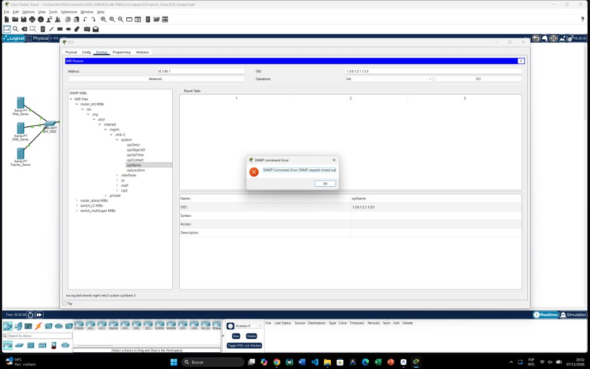

---

## 5. Retos Técnicos Presentados y Soluciones Aplicadas (Análisis por Capas TCP/IP)

- **Bluetooth y TCP.** Se separó la prueba de recepción BLE de la del socket. Cuando el Tracker seguía devolviendo ACK y PC7 dejó de recibir, se comprobó el puerto 5001 localmente y se reprodujo el timeout desde el servidor. Reabrir Packet Tracer y arrancar PC7 → Tracker → PC4 → Beacon restableció el flujo. La [incidencia](CIERRE_FUNCIONAL_2026-11-08.md#2-incidencia-resuelta-durante-la-validación) deja abierta la causa raíz.
- **Retorno SNMP en Madrid.** El ajuste de la ACL de tránsito fue seguido por GET/SET exitosos hacia R2_ESP. La [consulta directa al MLSW](EVIDENCIAS_VALIDACION_2026-11-08.md#4-diagnóstico--consulta-directa-a-mlsw_mad-pendiente) conserva su timeout como resultado de diagnóstico.

| Capa TCP/IP | Problema Encontrado durante el Desarrollo | Causa Raíz Identificada | Solución de Ingeniería Aplicada |
|---|---|---|---|
| **Capa 2 (Acceso a Red)** | Pérdida aparente de VLANs en archivos exportados de `startup-config` | El serializador interno de Packet Tracer corta líneas con comas en el JSON de exportación | Se verificó en vivo con `show interfaces trunk` y `show vlan brief` (`evidencias/vlans_*.txt`), confirmando las VLANs `35,40,80,99` activas en los 7 switches. |
| **Capa 3 (Internet - IPv4)** | Falta de conectividad de retorno hacia la VLAN 80 de Madrid (`10.3.81.0/24`) | El resumen estático `10.3.128.0/17` en `R2_ESP` solo cubre `10.3.128.0`–`10.3.255.255`, dejando por fuera a `10.3.81.0/24` | Se agregó la ruta estática específica `ip route 10.3.81.0 255.255.255.0 10.3.200.2` en `R2_ESP` y se redistribuyó en `EIGRP AS 3`. |
| **Capa 3 (Internet - Routing)**| Bucle de enrutamiento entre `ISP_BOG`, `ISP_FL` e `ISP_ESP` al redistribuir | Las rutas EIGRP externas (`AD = 170`) redistribuidas en OSPF (`AD = 110`) eran preferidas por OSPF, creando una ruta circular | Se configuró `distance ospf external 175` en los routers OSPF para que EIGRP externo (`170`) siempre tenga prelación sobre las rutas redistribuidas de vuelta. |
| **Capa 3 (Túnel IPv6 / IPsec)**| Caída de adyacencia `OSPFv3` al cambiar `Tunnel0` a modo GRE sobre IPsec | Limitación del motor de simulación de Packet Tracer al procesar multicast OSPFv3 sobre GRE cifrado | Se mantuvo `tunnel mode ipv6ip` con vecindad `OSPFv3 FULL` estable y rutas estáticas flotantes (`AD = 200`) de respaldo, y se demostró el cifrado `ESP AES-256` sobre el tráfico inter-sede. |
| **Capa 4/7 (Aplicación)** | El objeto `HTTPServer` en la pestaña Programming de `PC7` arroja error | El modelo `PC-PT` de Packet Tracer no soporta levantar un servidor web en el entorno JS (`HTTP server not supported on this device`) | Se implementó el Dashboard en tiempo real mediante `TCPServer` en el puerto `5001` con salida estructurada en consola (`ULTIMO`, `HISTORIAL CORTO` y alertas). |

---

## 6. Conclusiones y Recomendaciones

### Conclusiones
1. **Integración Exitosa de Arquitecturas Heterogéneas:** Se demostró la interoperabilidad completa entre dos arquitecturas LAN empresariales distintas (*Router-on-a-Stick* en Bogotá y *Multilayer Switching L3 con SVIs* en Madrid) interconectadas a través de un núcleo WAN multiprotocolo (`EIGRP AS 3` y `OSPFv2 Proceso 3`), logrando convergencia sin bucles mediante el control de la distancia administrativa (`AD = 175`) en el nodo de frontera `ISP_FL`.
2. **Transición gradual hacia IPv6:** La implementación del túnel manual `ipv6ip` (`Tunnel0`) junto con `OSPFv3` permitió conectar islas IPv6 nativas (`2001:1200:EA13::/48`, `2001:1200:EB23::/48` y la DMZ `2001:1200:EC13:10::/64`) a través de una infraestructura de proveedor exclusivamente IPv4, validando el acceso a servicios `DNS` (`AAAA`) y `HTTP/HTTPS` sin modificar el core de los ISPs.
3. **Alcance de los controles de seguridad:** Los contadores ESP respaldan el cifrado para el selector IPv4 observado. Las 16 pruebas Web respaldan el filtrado por rol en ambos protocolos. Las pruebas SNMP delimitan el acceso en los equipos ensayados y dejan abierta la consulta directa a MLSW_MAD.
4. **Telemetría Bluetooth y TCP:** El desarrollo en JavaScript del sistema **Employee Tracker** permitió observar recepción Bluetooth, reenvío, ACK de aplicación y alertas mediante sockets TCP (`puertos 5000 y 5001`), acuses de recibo de capa de aplicación (`ACK`) y máquinas de estado temporales para detectar condiciones críticas de seguridad física (`CAMBIO_BRUSCO` y permanencia $\ge 60\text{ s}$ en `ZONA_RESTRINGIDA`).

### Recomendaciones de Ingeniería
1. **Migración a Certificados Digitales y SNMPv3 en Producción:** En un despliegue físico con equipos Cisco IOS-XE reales, se recomienda reemplazar las llaves precompartidas (PSK) de IPsec por certificados X.509 (`PKI`) con `IKEv2`, y migrar de `SNMPv2c` a **`SNMPv3` (`authPriv`)** para cifrar las credenciales de gestión en tránsito.
2. **Redundancia de Borde y Alta Disponibilidad:** Incorporar un segundo enlace WAN o protocolo de redundancia de primer salto (**HSRP / VRRPv3**) en la sede Bogotá para eliminar el punto único de falla que representa el enlace físico único del esquema *Router-on-a-Stick*.
3. **Separación de Tráfico de Aplicaciones Críticas con QoS:** Implementar políticas de Calidad de Servicio (`DiffServ / DSCP`) en las interfaces seriales WAN para priorizar los paquetes TCP del **Employee Tracker** (`puertos 5000/5001`) frente al tráfico de navegación web de la VLAN de invitados.

---

## 7. Roles, Actividades y Contribuciones del Equipo

Asignaciones y evidencias consignadas en las actas. El paquete del 8 de noviembre no identifica responsables individuales de cada captura.

| Integrante | Rol Asignado | Actividades Específicas y Contribuciones Verificables | Archivos y Evidencias Asociadas |
|---|---|---|---|
| **Juan David Rubio** | Arquitecto de Red, Direccionamiento e Integración General | Diseño del esquema de direccionamiento VLSM IPv4 e IPv6 ($X=3$), configuración de VLANs/Trunks/STP en Bogotá y Madrid, configuración y pruebas de `SNMP` (`GET`, `SET` y bloqueo por ACL en MIB Browser), integración final del archivo `.pkt` y consolidación del repositorio. | [`direccionamiento_y_rubrica.xlsx`](../direccionamiento_y_rubrica.xlsx), [`Proyecto_Final_RCD_Equipo3.pkt`](../Proyecto_Final_RCD_Equipo3.pkt), [`snmp_get_pc4.jpg`](snmp_get_pc4.jpg), [`snmp_set_pc4.jpg`](snmp_set_pc4.jpg), [`snmp_timeout_bloqueado_pc1.jpg`](snmp_timeout_bloqueado_pc1.jpg) |
| **Yeison David Niño** | Especialista en Enrutamiento WAN, Migración IPv6 y Seguridad IPsec | Configuración de los 7 enlaces `/30` WAN, `EIGRP AS 3`, `OSPFv2 Proceso 3`, redistribución y ajuste de distancia administrativa (`175`) en `ISP_FL`, configuración de `Tunnel0` (`ipv6ip`), `OSPFv3` y VPN `IPsec` (`AES-256/SHA`) entre `R1_BOG` y `R2_ESP`. | [`R1_BOG_running.txt`](../configuraciones/R1_BOG_running.txt), [`R2_ESP_running.txt`](../configuraciones/R2_ESP_running.txt), [`ISP_FL_running.txt`](../configuraciones/ISP_FL_running.txt), [`final_ipsec_despues.txt`](../evidencias/final_ipsec_despues.txt) |
| **Miguel Medina** | Desarrollador de Servicios DMZ, ACLs y Aplicación Employee Tracker | Configuración de servidores en DMZ (`DNS_Server` con `mvydjdr.net`, `Web_Server` HTTP/HTTPS), diseño y verificación de la matriz `WEB-DMZ`, programación y prueba de los sockets TCP en JavaScript (`pt_pc4.js`, `pt_server.js`, `pt_pc7.js`) y captura de alertas del Tracker. | [`tracker/`](../tracker), [`tracker_pc4_running.jpg`](tracker_pc4_running.jpg), [`tracker_server_running.jpg`](tracker_server_running.jpg), [`tracker_zona_restringida.jpg`](tracker_zona_restringida.jpg), [`tracker_dashboard_pc7.jpg`](tracker_dashboard_pc7.jpg) |

*(Las actas detalladas de seguimiento y evaluación del equipo se encuentran en [`actas/ACTA_01.md`](../actas/ACTA_01.md) y [`actas/MATRIZ_CONTRIBUCIONES.md`](../actas/MATRIZ_CONTRIBUCIONES.md)).*

---

## 8. Declaración Obligatoria de Uso de Inteligencia Artificial (Sección 4.6)

En cumplimiento del numeral 4.6 de la guía del proyecto final, el equipo declara de manera transparente el uso de herramientas de Inteligencia Artificial como apoyo técnico y documental durante el desarrollo del laboratorio:

1. **Herramientas de IA Consultadas:**
   * **ChatGPT / OpenAI Codex (con integración MCP para Packet Tracer)**
   * **Google Gemini (Asistente de programación y documentación en el entorno de trabajo)**
2. **Enlace Público de Conversación y Registro de Instrucciones:**
   * **Enlace compartido de la sesión de trabajo en ChatGPT:** [https://chatgpt.com/s/cx_6aee127155d48191abedc299873f795d](https://chatgpt.com/s/cx_6aee127155d48191abedc299873f795d)
   * **Conversación de auditoría del 8 de noviembre:** [ChatGPT](https://chatgpt.com/share/6af11005-fd58-83e9-b77f-858093f84483).
   * **Registro de prompts e instrucciones enviadas:** Documentado en [`DECLARACION_IA.md`](../DECLARACION_IA.md). Las consultas abarcaron la estructuración del plan de direccionamiento con $X=3$, la sintaxis de redistribución EIGRP/OSPF sin bucles, la programación de sockets TCP en la API JavaScript de Packet Tracer (`TCPClient`/`TCPServer`), la corrección de las comunidades SNMP en `SW1_BOG`, `R2_ESP` y `MLSW_MAD`, y la estructuración del reporte técnico bajo normas IEEE.
3. **Proceso de Validación y Aplicación por parte del Equipo:**
   * El equipo contrastó las propuestas mediante pruebas específicas. El [registro detallado](../DECLARACION_IA.md#4-auditoría-del-8-de-noviembre) distingue los resultados observados y las propuestas descartadas.
   * Las comprobaciones históricas en Cisco Packet Tracer 9.0.1 incluyen:
     * Inspección de tablas de enrutamiento (`show ip route`, `show ipv6 route`) y adyacencias (`show ip ospf neighbor`, `show ipv6 ospf neighbor`).
     * Identificación y corrección de limitaciones reales del simulador (por ejemplo, el ajuste de sintaxis de `snmp-server community RCD3-RO RO` en switches 2960 que no admiten número de ACL al final en PT, y la ruta específica `10.3.81.0/24` fuera del bloque sumarizado `/17` en Madrid).
     * Ejecución interactiva de pruebas en el **MIB Browser** (`GET`, `SET` y confirmación de `Request timed out` desde la VLAN de invitados) y verificación en tiempo real de las consolas del **Employee Tracker** hasta superar los 60 segundos continuos en zona restringida.

---

## 9. Referencias Bibliográficas (Normas IEEE)

[1] J. M. Aranda L. K. y S. E. Quevedo G., “Proyecto final. Diseño e implementación de una red empresarial,” Asignatura Redes y Comunicación de Datos (2026-2), versión 1.0, oct. 2026, pp. 1–5.  
[2] Docentes RCD, “Rúbricas PF RCD 262 — Hoja T_1,” Asignatura Redes y Comunicación de Datos, 2026.  
[3] S. Thomson, T. Narten, and T. Jinmei, “IPv6 Stateless Address Autoconfiguration,” Internet Engineering Task Force (IETF), RFC 4862, Sep. 2007. [Online]. Available: https://www.rfc-editor.org/rfc/rfc4862  
[4] R. Coltun, D. Ferguson, J. Moy, and A. Lindem, “OSPF for IPv6,” Internet Engineering Task Force (IETF), RFC 5340, Jul. 2008. [Online]. Available: https://www.rfc-editor.org/rfc/rfc5340  
[5] S. Kent and K. Seo, “Security Architecture for the Internet Protocol,” Internet Engineering Task Force (IETF), RFC 4301, Dec. 2005. [Online]. Available: https://www.rfc-editor.org/rfc/rfc4301  
[6] R. Presuhn, Ed., “Version 2 of the Protocol Operations for the Simple Network Management Protocol (SNMP),” Internet Engineering Task Force (IETF), RFC 3416, Dec. 2002. [Online]. Available: https://www.rfc-editor.org/rfc/rfc3416  
[7] R. Droms, J. Bound, B. Volz, T. Lemon, C. Perkins, and M. Carney, “Dynamic Host Configuration Protocol for IPv6 (DHCPv6),” Internet Engineering Task Force (IETF), RFC 3315, Jul. 2003. [Online]. Available: https://www.rfc-editor.org/rfc/rfc3315  
[8] Cisco Systems, “Cisco Packet Tracer 9.0.1 User Guide and IoT JavaScript API Reference,” San Jose, CA, USA, 2026.
